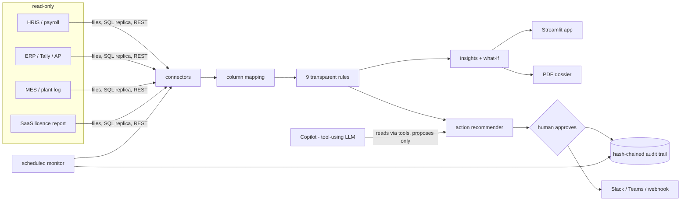

# Architecture

| Module | Role |
|---|---|
| `archenex/detectors.py` | The rules. Pure functions, every rupee computed from evidence rows |
| `archenex/mapping.py` | Client column names → canonical fields; safe-default rules |
| `archenex/connectors/` | `files`, `sql` (read-only guard), `rest` (https-only, private-IP block, pagination) |
| `archenex/insights.py` | Concentration, trend, compound hotspots, scenarios |
| `archenex/charts.py` | Plotly for the app, matplotlib twins for the PDF |
| `archenex/agent.py` | Action recommender, grounded Copilot, AI brief with figure check |
| `archenex/store.py` | SQLite: clients, run summaries, mappings, hash-chained audit. No raw rows |
| `archenex/dispatch.py` | Approved action → webhook (dry-run by default) |
| `archenex/auth.py` | PBKDF2 users with roles |
| `archenex/cli.py` | `demo` and `monitor` |

## Design rules
1. **Detect with rules, explain with AI.** The LLM never produces a number; it calls tools that do.
2. **Recommend, never execute.** Every action needs a named human decision.
3. **Read-only on client systems.**
4. **Store aggregates, not people.**

## Scaling path
SQLite is fine for a pilot or a single-tenant container. For multi-client SaaS move `store.py` to Postgres (the
SQL is plain), run connectors as a background worker, and add SSO (OIDC). Large exports (millions of rows): push
aggregation into the SQL queries or move the engine to DuckDB/Polars.
